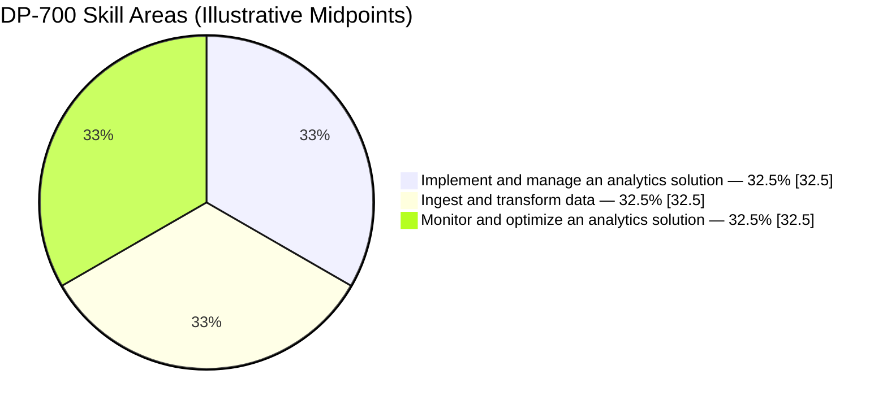
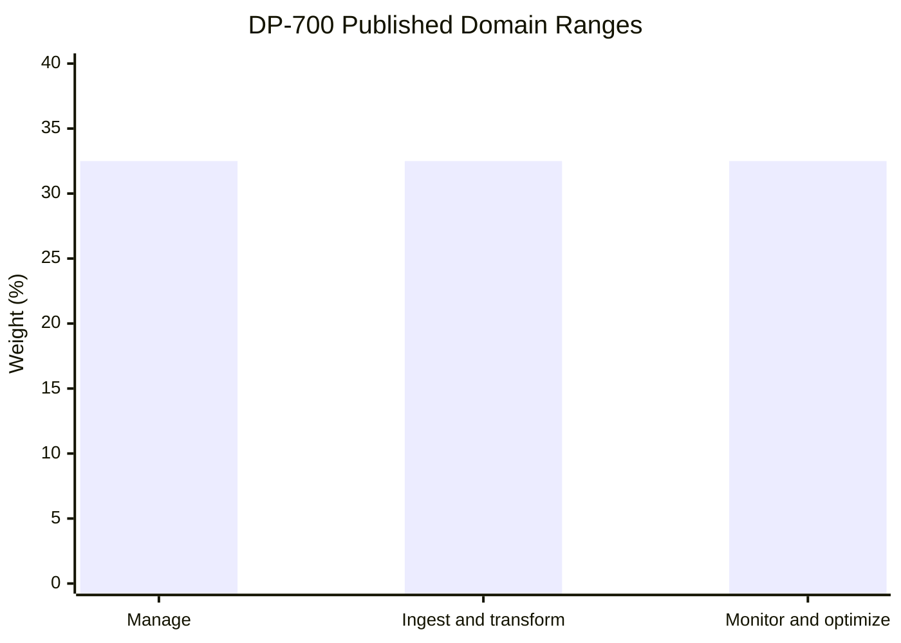
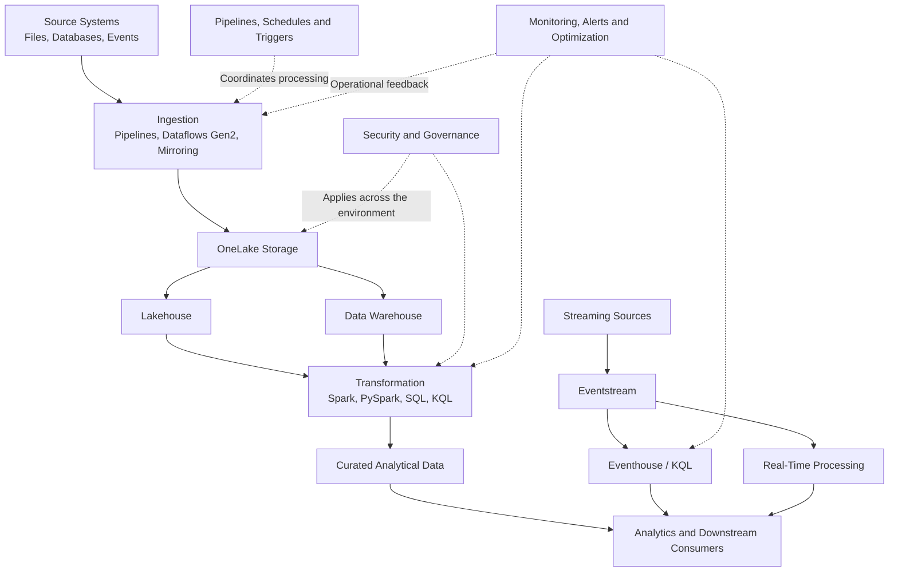
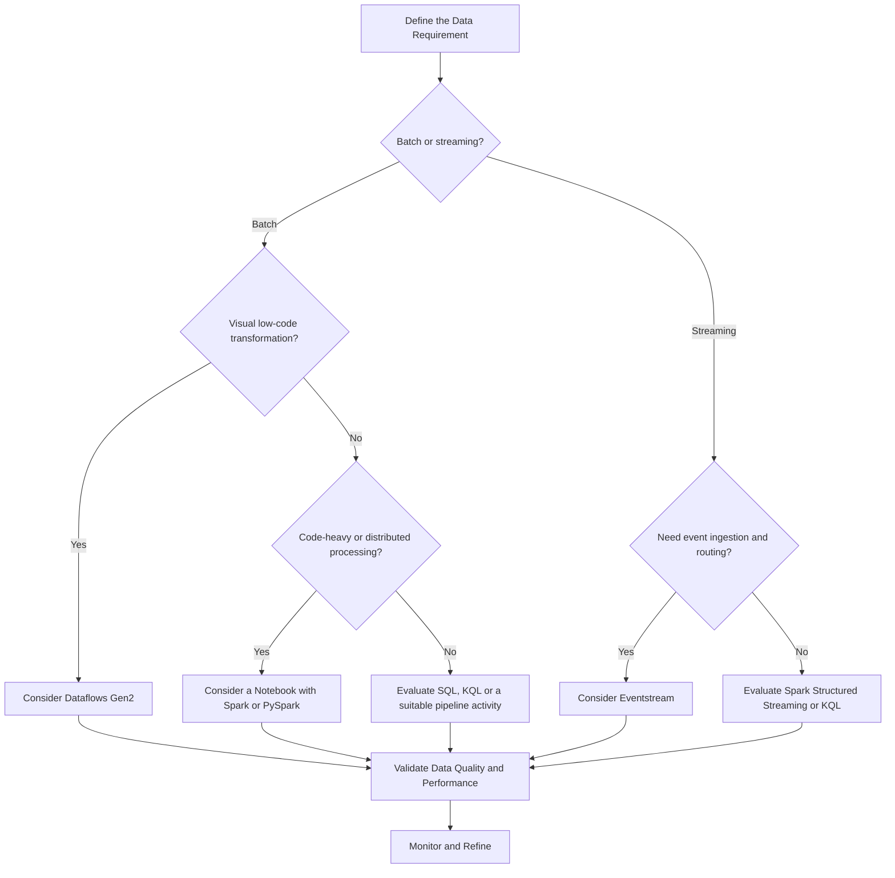
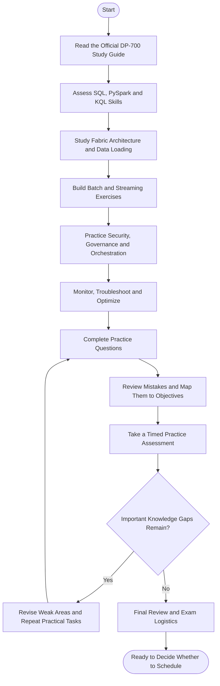
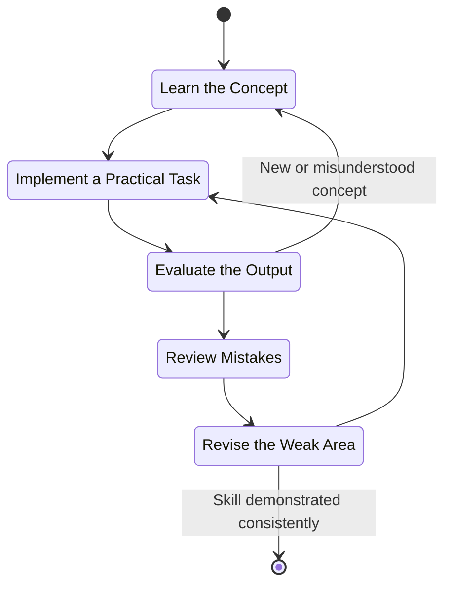
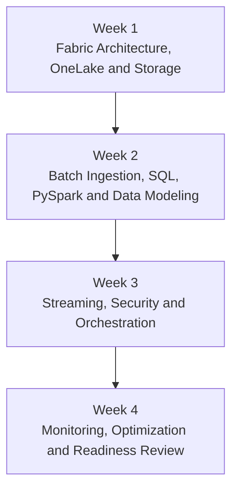
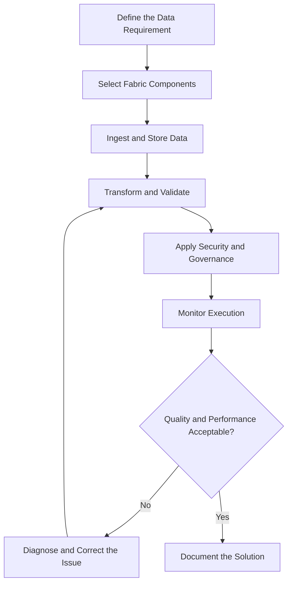

# Microsoft DP-700: Fabric Data Engineer Associate Study Guide

A practical study guide for **Microsoft DP-700: Implementing Data Engineering Solutions Using Microsoft Fabric**. Learn how to ingest and transform data, build lakehouse and data warehouse solutions, orchestrate pipelines, work with streaming data, secure analytics environments, and optimize data engineering workloads.

This repository combines exam objectives, architecture diagrams, study roadmaps, original practice questions, and hands-on project ideas to support structured preparation.

---

## Table of Contents

- [1. Overview](#1-overview)
- [2. About the DP-700 Certification](#2-about-the-dp-700-certification)
- [3. Who Should Prepare?](#3-who-should-prepare)
- [4. Official Exam Objectives](#4-official-exam-objectives)
- [5. Exam Domain Weightage](#5-exam-domain-weightage)
- [6. Microsoft Fabric Data Engineering Architecture](#6-microsoft-fabric-data-engineering-architecture)
- [7. Data Ingestion Decision Guide](#7-data-ingestion-decision-guide)
- [8. Certification Preparation Flowchart](#8-certification-preparation-flowchart)
- [9. Study and Revision Cycle](#9-study-and-revision-cycle)
- [10. Step-by-Step DP-700 Preparation](#10-step-by-step-dp-700-preparation)
- [11. Suggested Study Roadmap](#11-suggested-study-roadmap)
- [12. Practice Questions and Mock Tests](#12-practice-questions-and-mock-tests)
- [13. Hands-On Projects](#13-hands-on-projects)
- [14. Common Preparation Mistakes](#14-common-preparation-mistakes)
- [15. Career Relevance](#15-career-relevance)
- [16. Frequently Asked Questions](#16-frequently-asked-questions)
- [17. Official Learning Resources](#17-official-learning-resources)
- [18. About CertsGate](#18-about-certsgate)

---

## 1. Overview

Modern analytics platforms need reliable data pipelines, consistent transformations, secure storage, and effective monitoring. Microsoft Fabric brings several data and analytics capabilities into one environment, allowing data engineers to build solutions that serve reporting, analytics, and real-time data needs.

The **DP-700 study guide** is intended to help learners organize the skills needed to implement data engineering solutions with Microsoft Fabric. It focuses on three broad responsibilities: implementing and managing an analytics solution, ingesting and transforming data, and monitoring and optimizing the resulting workloads.

The most useful preparation combines documentation with practical work. For example, understanding an incremental load is important, but implementing one and checking how it handles duplicate records or late-arriving data makes the concept much more concrete.

### What this repository covers

- Microsoft Fabric workspaces, OneLake, and environment management.
- Data ingestion using pipelines, Dataflows Gen2, notebooks, and shortcuts.
- Lakehouse and data warehouse design.
- SQL, PySpark, and Kusto Query Language (KQL).
- Batch and streaming data processing.
- Eventstream, Eventhouse, and real-time intelligence.
- Security, governance, deployment, and orchestration.
- Monitoring, troubleshooting, and performance optimization.

Start with the [official DP-700 exam page](https://learn.microsoft.com/en-us/credentials/certifications/exams/dp-700/) and the [Microsoft study guide](https://learn.microsoft.com/en-us/credentials/certifications/resources/study-guides/dp-700). These should be your primary references when confirming current requirements.

---

## 2. About the DP-700 Certification

**DP-700: Implementing Data Engineering Solutions Using Microsoft Fabric** is the exam associated with the **Microsoft Certified: Fabric Data Engineer Associate** certification.

Microsoft describes the intended candidate as someone with expertise in data loading patterns, data architectures, and orchestration processes. The role involves ingesting and transforming data, securing and managing analytics solutions, and monitoring and optimizing workloads.

### Exam information

| Item | Details |
|---|---|
| Exam code | DP-700 |
| Exam title | Implementing Data Engineering Solutions Using Microsoft Fabric |
| Certification | Microsoft Certified: Fabric Data Engineer Associate |
| Provider | Microsoft |
| Level | Intermediate |
| Primary platform | Microsoft Fabric |
| Skills measured | Analytics solution management, data ingestion and transformation, monitoring and optimization |
| Exam duration | 100 minutes, according to Microsoft's exam page |
| Passing score | 700 or greater |
| Current English objective version | Skills measured as of October 19, 2026 |
| Official study guide | [DP-700 Study Guide](https://learn.microsoft.com/en-us/credentials/certifications/resources/study-guides/dp-700) |
| Exam registration | [Microsoft DP-700 exam page](https://learn.microsoft.com/en-us/credentials/certifications/exams/dp-700/) |

Microsoft may update the exam, its objectives, delivery experience, or regional details. Check the official exam page before scheduling. The number of questions can vary, so this README does not assume a fixed question count.

### Recommended background

Microsoft recommends experience working with data loading patterns, architectures, and orchestration. Candidates should be comfortable manipulating and transforming data with one or more of these technologies:

- **SQL** for querying and transforming relational data.
- **PySpark** for distributed data processing with Spark.
- **KQL** for querying and analyzing event and time-series data.

Experience with data extraction, transformation, and loading (ETL/ELT), data modeling, and cloud-based analytics will also help.

---

## 3. Who Should Prepare?

DP-700 is designed for people who want to demonstrate practical data engineering skills in Microsoft Fabric.

It may be relevant to:

- Data engineers building ingestion and transformation pipelines.
- Analytics engineers working with lakehouses and warehouses.
- SQL developers moving toward modern cloud data platforms.
- Data professionals using Spark or KQL.
- Cloud practitioners responsible for analytics workloads.
- Developers who want to understand Fabric data orchestration and monitoring.

If you are new to data engineering, begin with SQL, data modeling, and basic ETL concepts. If you already work with data pipelines, focus on how Fabric organizes storage, transformation, orchestration, governance, and monitoring.

---

## 4. Official Exam Objectives

Microsoft's study guide lists three main skill areas. The detailed subskills below reflect the published guide as of October 19, 2026.

### Domain 1: Implement and manage an analytics solution — 30–35%

This area covers the configuration, security, governance, and lifecycle management of a Fabric analytics environment.

**Configure Microsoft Fabric workspace settings**
- Configure Spark workspace settings.
- Configure domain workspace settings.
- Configure OneLake workspace settings.
- Configure Apache Airflow workspace settings.

**Implement lifecycle management**
- Configure version control.
- Implement database projects.
- Create and configure deployment pipelines.

**Configure security and governance**
- Implement workspace-level and item-level access controls.
- Apply row-level, column-level, object-level, and folder/file-level access controls.
- Implement dynamic data masking.
- Apply sensitivity labels and endorse items.
- Implement and use Microsoft Fabric audit logs.
- Configure and implement OneLake security.

**Orchestrate processes**
- Choose between Dataflow Gen2, a pipeline, and a notebook.
- Design scheduled and event-based triggers.
- Implement orchestration patterns using notebooks and pipelines, including parameters and dynamic expressions.

### Domain 2: Ingest and transform data — 30–35%

This area focuses on moving data into Fabric and preparing it for analytical use.

**Design loading patterns**
- Implement full and incremental data loads.
- Prepare data for a dimensional model.
- Design loading patterns for streaming data.

**Ingest and transform batch data**
- Choose an appropriate data store.
- Select between Dataflows Gen2, notebooks, KQL, and T-SQL for transformation.
- Create and manage OneLake shortcuts.
- Implement mirroring.
- Ingest data using pipelines.
- Transform data with PySpark, SQL, and KQL.
- Denormalize data and perform grouping and aggregation.
- Handle duplicate, missing, and late-arriving data.

**Ingest and transform streaming data**
- Choose an appropriate streaming engine.
- Select between native tables and OneLake shortcuts in Real-Time Intelligence.
- Understand query acceleration for OneLake shortcuts versus standard shortcuts.
- Process data using Eventstream, Spark Structured Streaming, and KQL.
- Create windowing functions.

### Domain 3: Monitor and optimize an analytics solution — 30–35%

This area covers operational reliability and performance.

**Monitor Fabric items**
- Monitor data ingestion and transformation.
- Monitor semantic model refresh.
- Configure alerts.

**Identify and resolve errors**
- Troubleshoot pipelines and Dataflows Gen2.
- Diagnose notebook and T-SQL errors.
- Resolve Eventhouse and Eventstream errors.
- Investigate OneLake shortcut issues.

**Optimize performance**
- Optimize lakehouse tables.
- Optimize pipelines and data warehouses.
- Optimize Eventstream and Eventhouse.
- Improve Spark and query performance.

For exact subskill wording, consult the [official DP-700 study guide](https://learn.microsoft.com/en-us/credentials/certifications/resources/study-guides/dp-700).

---

## 5. Exam Domain Weightage

Microsoft publishes a range of **30–35% for each of the three domains**. The diagrams below use the midpoint of each range to illustrate the relative distribution. These midpoint values are not official fixed percentages.

The midpoint values total 97.5 because they are illustrative values for three independently published ranges. They are not intended to represent a normalized official score distribution.

### Comparing the domains

*Chart note: Each bar shows the 32.5% midpoint of a published 30–35% range. The actual exam may vary within Microsoft's published ranges.*

| Domain | Official range | Preparation emphasis |
|---|---:|---|
| Implement and manage an analytics solution | 30–35% | Security, governance, lifecycle management, and orchestration |
| Ingest and transform data | 30–35% | Batch and streaming ingestion, transformations, and loading patterns |
| Monitor and optimize an analytics solution | 30–35% | Troubleshooting, monitoring, and performance |

Because the ranges are identical, do not treat one domain as unimportant. Plan to practice all three, then adjust your time according to your demonstrated strengths and weaknesses.

---

## 6. Microsoft Fabric Data Engineering Architecture

The following diagram illustrates a conceptual Fabric data engineering workflow. It is a learning diagram, not an official reference architecture or a requirement to use every component in one solution.

### Understanding the main components

| Component | Role in a data engineering workflow |
|---|---|
| OneLake | Fabric's unified logical data lake |
| Lakehouse | Combines file-based storage and analytical table capabilities |
| Data warehouse | Provides a warehouse-oriented analytical data store with SQL capabilities |
| Data Factory pipelines | Orchestrate ingestion and multi-step processing |
| Dataflows Gen2 | Provide a visual approach to data ingestion and transformation |
| Notebooks | Support code-based processing, including Spark and PySpark |
| Eventstream | Ingests and processes event streams |
| Eventhouse | Supports event-oriented analytical storage and KQL-based analysis |
| Governance and security | Control access, protection, and oversight |
| Monitoring | Helps detect failures, refresh problems, and performance issues |

The right combination depends on the data source, latency requirement, transformation complexity, storage design, and operational needs.

---

## 7. Data Ingestion Decision Guide

DP-700 expects candidates to select suitable Fabric components for different tasks. Avoid assuming that every transformation belongs in a notebook or every ingestion task requires a pipeline.

This is a simplified selection aid. In real solutions, ingestion, orchestration, transformation, and storage may use several components together.

### Common component comparisons

| Requirement | Components to evaluate | Important consideration |
|---|---|---|
| Orchestrate a multi-step process | Pipeline | Dependencies, parameters, schedules, and retries |
| Perform visual data preparation | Dataflows Gen2 | Transformation steps and data-source support |
| Perform code-based distributed transformation | Notebook with Spark/PySpark | Compute, partitioning, and execution cost |
| Query event-oriented data | KQL and Eventhouse | Query patterns and event-data characteristics |
| Analyze relational analytical data | T-SQL and a warehouse | SQL requirements, modeling, and workload |
| Reuse existing data without unnecessary duplication | OneLake shortcuts | Source support, access, and query behavior |

---

## 8. Certification Preparation Flowchart

Use this workflow to turn the official DP-700 objectives into a structured preparation plan.

A practice assessment is a diagnostic checkpoint, not a guarantee. Before scheduling, confirm that you can explain component choices and troubleshoot scenarios rather than simply recognize familiar answers.

---

## 9. Study and Revision Cycle

Data engineering knowledge improves through repeated implementation and review. Use this cycle whenever you study a new Fabric feature or encounter a mistake.

### Apply the cycle to a concrete example

Suppose an incremental load duplicates records when it runs a second time.

1. **Learn:** Review how incremental loading and keys work.
2. **Practice:** Run the pipeline twice against the same sample data.
3. **Evaluate:** Compare record counts and business keys.
4. **Review:** Identify why the second run creates duplicates.
5. **Revise:** Improve the merge, deduplication, or checkpoint logic and rerun the test.

This approach builds the kind of reasoning needed for real data engineering tasks and scenario-based exam questions.

---

## 10. Step-by-Step DP-700 Preparation

### Step 1: Turn the study guide into a checklist

Download or review the [official DP-700 study guide](https://learn.microsoft.com/en-us/credentials/certifications/resources/study-guides/dp-700).

Create a checklist covering every skill. For each item, record whether you have read about it, practiced it, and can explain when to use it.

### Step 2: Review SQL, PySpark, and KQL

You do not need to master every language equally, but you should understand the role each plays.

- **SQL/T-SQL:** Filtering, joins, aggregations, analytical transformations, and warehouse queries.
- **PySpark:** Distributed processing, DataFrame transformations, joins, and aggregations.
- **KQL:** Filtering, summarizing, projecting, and analyzing event-oriented data.

Practice the same transformation in more than one language where appropriate. This helps clarify when a technology is a natural fit.

### Step 3: Learn the Fabric storage model

Study OneLake, lakehouses, warehouses, and shortcuts.

Understand the difference between storing and transforming data, querying it, and making it available to downstream consumers. Learn why a shortcut can be useful and what access or performance considerations it introduces.

### Step 4: Build batch ingestion patterns

Practice a pipeline that ingests source data, applies transformations, and writes a curated result.

Include:

- Full loads.
- Incremental loads.
- Duplicate detection.
- Missing values.
- Late-arriving records.
- Aggregations and dimensional modeling.

Test reruns and partial failures. A pipeline that succeeds once but duplicates data on retry is not a reliable solution.

### Step 5: Practice streaming and real-time processing

Learn the purpose of Eventstream, Eventhouse, KQL, and Spark Structured Streaming.

Understand windowing, late-arriving events, the difference between streaming and batch processing, and how to select a suitable approach for the latency and query requirements.

### Step 6: Study security and governance

Practice choosing appropriate access controls and understand the differences between workspace-level and item-level permissions.

Review OneLake security, sensitivity labels, dynamic data masking, audit logs, and data-level controls. Be able to identify which control best addresses a given requirement.

### Step 7: Learn orchestration and lifecycle management

Practice parameters, dynamic expressions, schedules, event-based triggers, and dependencies between pipeline activities.

Also review version control, database projects, and deployment pipelines. Understand how changes can move through development and deployment environments while reducing avoidable configuration errors.

### Step 8: Monitor and optimize

Learn to identify failures in pipelines, notebooks, Dataflows Gen2, Eventstream, Eventhouse, SQL, and shortcuts.

For performance tasks, investigate the actual bottleneck before changing settings. Consider data volume, query patterns, partitioning, table layout, Spark workload behavior, and unnecessary processing.

### Step 9: Use practice assessments intelligently

Microsoft provides a practice assessment through the official exam preparation page. Use it to evaluate your knowledge and identify topics for additional review.

For each incorrect or uncertain answer:

1. Identify the relevant exam objective.
2. Explain the underlying concept.
3. Check the official documentation.
4. Recreate the scenario in Fabric if practical.
5. Try a different question or implementation task.

You can also use [CertsGate's Microsoft exam preparation resources](https://certsgate.com/exams/microsoft) as an independent supplement. Confirm technical answers against current Microsoft documentation.

---

## 11. Suggested Study Roadmap

This four-week roadmap is an independent preparation example, not a Microsoft-required timetable. Adjust it based on your existing data engineering experience and access to a Fabric environment.

| Week | Main focus | Suggested practical outcome |
|---|---|---|
| 1 | Fabric workspaces, OneLake, lakehouse, warehouse, security foundations | Explain the data platform and create a simple storage workflow |
| 2 | Pipelines, Dataflows Gen2, SQL, PySpark, loading patterns | Build and test a batch ingestion pipeline |
| 3 | Eventstream, Eventhouse, KQL, governance, orchestration | Process a sample event stream and review access controls |
| 4 | Monitoring, troubleshooting, performance, practice assessment | Diagnose sample failures and revise weak objectives |

### Example weekly routine

- **Concept study:** Read the relevant Microsoft Learn material.
- **Hands-on practice:** Implement a small task in Fabric.
- **Knowledge check:** Answer questions about the task and its alternatives.
- **Mistake review:** Record gaps and revisit the official objective.
- **Weekly recap:** Explain what you learned without relying on notes.

Prioritize practical exercises for skills that are unfamiliar. Avoid spending all your time reading while leaving the implementation objectives untested.

---

## 12. Practice Questions and Mock Tests

Practice questions are most useful when they reveal how well you can apply a concept to a requirement. The examples below are original educational questions created for this repository. They are **not official Microsoft exam questions**.

### Question 1: Incremental loading

A pipeline processes a large source table every day, but only a small number of records change between runs. The solution must avoid reprocessing the entire dataset unnecessarily. Which approach should you investigate first?

A. Use a full load on every run regardless of source changes.  
B. Implement an incremental loading pattern based on a suitable change indicator.  
C. Remove all keys from the destination table.  
D. Disable monitoring.

Show answer and explanation

**Correct answer: B.**

An incremental loading pattern processes new or changed records according to a suitable change indicator or source mechanism. The implementation must also account for updates, deletes where applicable, reruns, and late-arriving data.

### Question 2: Choosing a transformation tool

A data team wants a code-based transformation that can process a large dataset using Spark. Which option is the most suitable starting point?

A. A notebook using Spark or PySpark  
B. A sensitivity label  
C. A workspace description  
D. An audit log alone

Show answer and explanation

**Correct answer: A.**

A Spark-enabled notebook supports code-based distributed processing. The final choice should still account for the transformation, data size, compute requirements, and available Fabric capabilities.

### Question 3: Event data

A solution needs to ingest continuous events and make them available for event-oriented analysis. Which combination should you investigate?

A. Eventstream and Eventhouse with KQL where appropriate  
B. A static spreadsheet and manual refresh only  
C. A database project without an ingestion mechanism  
D. A sensitivity label as the primary processing engine

Show answer and explanation

**Correct answer: A.**

Eventstream can support event ingestion and processing, while Eventhouse and KQL support event-oriented storage and analysis. The precise architecture depends on the event source and the workload.

### Question 4: Data access

A requirement states that users should see only rows permitted by a data-access policy. Which type of control should you investigate?

A. Row-level security  
B. Pipeline scheduling  
C. Spark pool naming  
D. Data aggregation

Show answer and explanation

**Correct answer: A.**

Row-level security restricts which rows a user can access. The implementation depends on the data item, supported security capabilities, and how user identity is evaluated.

### Question 5: Pipeline troubleshooting

A scheduled pipeline fails after a source schema changes. What is the most useful first step?

A. Disable all error reporting.  
B. Inspect the failed activity and error details, then verify the source schema and transformation assumptions.  
C. Delete all monitoring history.  
D. Assume the failure is caused by insufficient storage without investigating.

Show answer and explanation

**Correct answer: B.**

Start with evidence from the failed activity. Confirm whether the schema change affected mappings, expressions, data types, or downstream transformations before choosing a fix.

### How to use a DP-700 mock test

After each attempt:

- Review incorrect answers and answers selected by guessing.
- Map each mistake to the official exam domain.
- Read the relevant Microsoft documentation.
- Repeat the concept in a hands-on exercise where possible.
- Retest yourself with a different scenario.

Use the [official DP-700 exam page](https://learn.microsoft.com/en-us/credentials/certifications/exams/dp-700/) to access Microsoft's practice assessment and exam sandbox.

---

## 13. Hands-On Projects

The projects below turn exam topics into practical data engineering exercises. Use sample or synthetic data and verify the current Fabric capabilities, licensing requirements, and workspace permissions before starting.

### Project 1: Batch ingestion pipeline

**Goal:** Ingest sample sales data into Fabric and produce a cleaned analytical dataset.

Tasks:
- Ingest source data through a suitable pipeline or Dataflow Gen2 workflow.
- Store the raw data in an appropriate location.
- Transform records with SQL or PySpark.
- Handle duplicate and missing values.
- Write a curated output.

**What to learn:** Data movement, transformations, loading patterns, and data quality.

### Project 2: Incremental load with rerun safety

**Goal:** Process only new or changed records without creating duplicates when a pipeline is rerun.

Tasks:
- Create a sample source dataset with a stable business key.
- Define a change-detection approach.
- Implement the incremental load.
- Run the process more than once.
- Introduce an update and a duplicate to test the logic.

**What to learn:** Incremental ingestion, idempotency, deduplication, and reliable pipeline design.

### Project 3: Lakehouse transformation workflow

**Goal:** Build a simple lakehouse workflow that transforms raw records into curated analytical tables.

Tasks:
- Store raw data.
- Use a notebook with Spark/PySpark or an appropriate SQL workflow.
- Clean and standardize records.
- Join related datasets.
- Create grouped and aggregated outputs.
- Compare the result against expected values.

**What to learn:** Lakehouse design, transformations, dimensional preparation, and query behavior.

### Project 4: Real-time event processing

**Goal:** Process a stream of sample events and calculate a time-based summary.

Tasks:
- Identify a suitable event source.
- Configure a supported Eventstream workflow.
- Route data to an appropriate destination.
- Use KQL or another suitable processing mechanism.
- Experiment with event-time windows.
- Investigate missing or late-arriving events.

**What to learn:** Streaming architecture, event processing, windowing, and operational monitoring.

### Project 5: Secure and deploy an analytics solution

**Goal:** Prepare a simple solution for controlled development and deployment.

Tasks:
- Review workspace and item-level permissions.
- Identify appropriate data-level controls.
- Apply suitable governance settings.
- Explore version control and deployment pipelines.
- Verify access after deployment.

**What to learn:** Security, governance, lifecycle management, and repeatable deployment.

### Project 6: Monitor and optimize a pipeline

**Goal:** Find and resolve a deliberate failure or performance issue in a sample workload.

Tasks:
- Record expected processing behavior.
- Introduce a controlled issue, such as an incorrect mapping.
- Inspect monitoring information and error details.
- Identify the root cause.
- Apply a correction.
- Compare execution behavior before and after the change.

**What to learn:** Troubleshooting, alerts, performance investigation, and operational reliability.

### Project workflow

For each project, document the architecture, decisions, assumptions, validation checks, errors encountered, and improvements. These notes make useful revision material and demonstrate that you understand why a solution works.

---

## 14. Common Preparation Mistakes

### Studying tools without learning when to use them

Knowing where to click is not the same as choosing the right component. Compare pipelines, Dataflows Gen2, notebooks, SQL, KQL, and streaming tools according to the actual requirement.

### Ignoring incremental loading

Incremental loading introduces important considerations such as change detection, duplicate handling, reruns, and late-arriving data. Practice these behaviors rather than memorizing a definition.

### Focusing only on batch processing

The objectives include streaming ingestion, Eventstream, Spark Structured Streaming, KQL, and windowing. Include real-time workloads in your preparation.

### Neglecting governance and security

Workspace permissions are not the only security concern. Review item-level and data-level controls, sensitivity labels, dynamic data masking, audit logs, and OneLake security.

### Treating successful execution as proof of correctness

A pipeline may finish successfully while producing duplicates, missing records, or incorrect aggregates. Validate row counts, keys, totals, and business rules.

### Ignoring monitoring and performance

Practice reading failure details and investigating bottlenecks. Avoid changing settings randomly without evidence about the underlying issue.

### Relying on memorized practice answers

A practice score cannot demonstrate that you can troubleshoot a new scenario. Explain why the selected component fits and why alternatives are less suitable.

### Using outdated exam guides

Microsoft's DP-700 English objectives were updated for October 19, 2026. Review the current study guide instead of assuming that older training material covers every current requirement.

---

## 15. Career Relevance

The Fabric Data Engineer Associate certification aligns with skills used to build and maintain analytics data platforms.

Preparing for DP-700 can help develop familiarity with:

- Data ingestion and transformation.
- Lakehouse and warehouse workflows.
- Distributed processing using Spark and PySpark.
- SQL-based analytics.
- Event-oriented processing with KQL.
- Pipeline orchestration and deployment.
- Security, governance, monitoring, and optimization.

These capabilities can be relevant to data engineering, analytics engineering, and cloud data platform work. The certification alone does not guarantee employment or prove advanced expertise. Practical projects and the ability to explain technical decisions remain important.

A useful portfolio project should show more than a successful run. Include its purpose, architecture, loading strategy, transformations, security decisions, monitoring approach, and known limitations.

---

## 16. Frequently Asked Questions

### What is DP-700?

DP-700 is Microsoft's exam for the Fabric Data Engineer Associate certification. It focuses on implementing and managing analytics solutions, ingesting and transforming data, and monitoring and optimizing workloads in Microsoft Fabric.

### What is the passing score for DP-700?

Microsoft lists a passing score of **700 or greater**. See Microsoft's [exam scoring and support information](https://learn.microsoft.com/en-us/credentials/certifications/exams/dp-700/) for current details. This score should not be interpreted as a simple percentage of questions answered correctly.

### How long is the DP-700 exam?

Microsoft currently lists 100 minutes for the exam. Confirm the current duration and seat-time details on the official exam page before your appointment.

### What are the DP-700 exam domains?

The published domains are:

1. Implement and manage an analytics solution — 30–35%.
2. Ingest and transform data — 30–35%.
3. Monitor and optimize an analytics solution — 30–35%.

Consult the current study guide for all individual skills.

### Which programming languages should I know?

Microsoft identifies SQL, PySpark, and KQL as relevant data manipulation and transformation skills. The depth you need depends on your existing experience, but you should understand what each technology is used for.

### Is DP-700 suitable for beginners?

The certification is intermediate rather than a fundamentals exam. Candidates benefit from prior experience with data integration, transformation, orchestration, and at least one relevant data language.

### How long does DP-700 preparation take?

There is no single timeline that suits every candidate. Your preparation period depends on your Fabric experience, familiarity with SQL/PySpark/KQL, practical access, and the time you can dedicate to study. Use the roadmap in this repository as a starting point.

### Where can I find official DP-700 practice questions?

Microsoft offers a practice assessment through the [official DP-700 exam page](https://learn.microsoft.com/en-us/credentials/certifications/exams/dp-700/). The exam sandbox is also useful for familiarizing yourself with the exam interface.

### Are third-party practice questions enough?

No single practice resource replaces the official objectives and hands-on learning. Use questions to locate knowledge gaps, then verify the underlying concepts through Microsoft documentation and practical exercises.

### Does DP-700 guarantee a data engineering job?

No. The certification can help demonstrate relevant knowledge, but hiring decisions depend on many factors, including practical experience, project work, communication, and employer requirements.

---

## 17. Official Learning Resources

Start with Microsoft's current certification documentation and use the linked learning paths to practice each objective.

| Resource | How it helps |
|---|---|
| [DP-700 Exam Page](https://learn.microsoft.com/en-us/credentials/certifications/exams/dp-700/) | Exam information, current preparation links, practice assessment, and exam sandbox |
| [DP-700 Study Guide](https://learn.microsoft.com/en-us/credentials/certifications/resources/study-guides/dp-700) | Published domains, detailed skills, and objective updates |
| [Fabric Data Engineer Associate](https://learn.microsoft.com/en-us/credentials/certifications/fabric-data-engineer-associate/) | Certification overview and preparation resources |
| [DP-700 Official Course](https://learn.microsoft.com/en-us/training/courses/dp-700t00) | Instructor-led course and related self-study material |
| [Microsoft Fabric Documentation](https://learn.microsoft.com/en-us/fabric/) | Core platform documentation |
| [Microsoft Fabric Training](https://learn.microsoft.com/en-us/training/fabric/) | Learning paths for Fabric workloads |
| [OneLake Documentation](https://learn.microsoft.com/en-us/fabric/onelake/onelake-overview) | Storage concepts and shortcuts |
| [Fabric Lakehouse Documentation](https://learn.microsoft.com/en-us/fabric/data-engineering/lakehouse-overview) | Lakehouse concepts and engineering workflows |
| [Fabric Data Warehouse Documentation](https://learn.microsoft.com/en-us/fabric/data-warehouse/) | Warehouse concepts and SQL analytics |
| [Data Factory in Fabric](https://learn.microsoft.com/en-us/fabric/data-factory/) | Pipelines, Dataflows Gen2, and data integration |
| [Real-Time Intelligence](https://learn.microsoft.com/en-us/fabric/real-time-intelligence/) | Eventstream, Eventhouse, and real-time data workflows |
| [Fabric Security](https://learn.microsoft.com/en-us/fabric/security/) | Access control and security guidance |
| [Microsoft Fabric Blog](https://blog.fabric.microsoft.com/) | Product updates and technical announcements |

### Suggested order of study

1. Read the official DP-700 objectives.
2. Study Fabric architecture, OneLake, and storage choices.
3. Build batch ingestion and transformation workflows.
4. Practice streaming and real-time intelligence.
5. Configure security, governance, and orchestration.
6. Monitor, troubleshoot, and optimize workloads.
7. Take the official practice assessment and revise weak areas.

Product capabilities and documentation URLs can change. If a page moves, follow the links from Microsoft's current study guide or Fabric documentation.

---

## 18. About CertsGate

[CertsGate.com](https://certsgate.com/) provides independent IT certification preparation resources for people studying for technology exams.

For DP-700, supplementary study material and practice questions can help reinforce concepts and identify topics that need further review. A useful workflow is to answer a question, explain the reasoning, connect the result to an official exam objective, and revisit Microsoft documentation for confirmation.

Explore the [CertsGate Microsoft exam preparation section](https://certsgate.com/exams/microsoft) for related resources.

**Final preparation principle:** Learn the official objectives, build data pipelines, understand component selection, practice batch and streaming workloads, secure the environment, and use monitoring and mistake analysis to strengthen your weak areas.
